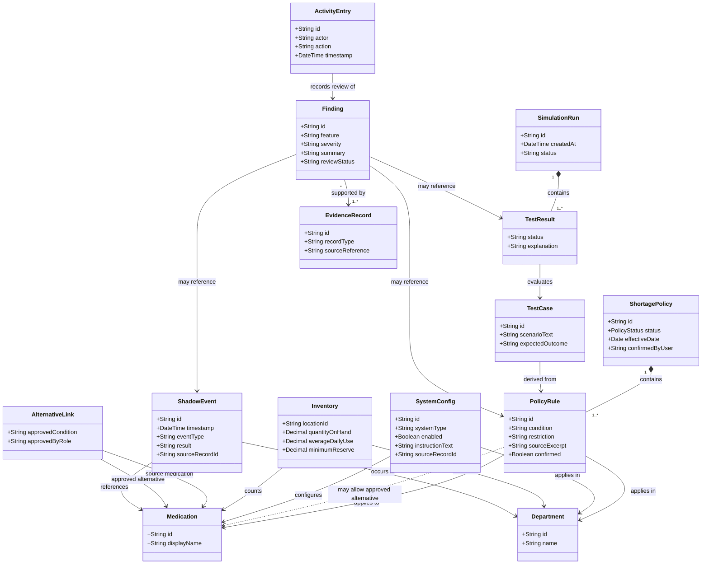
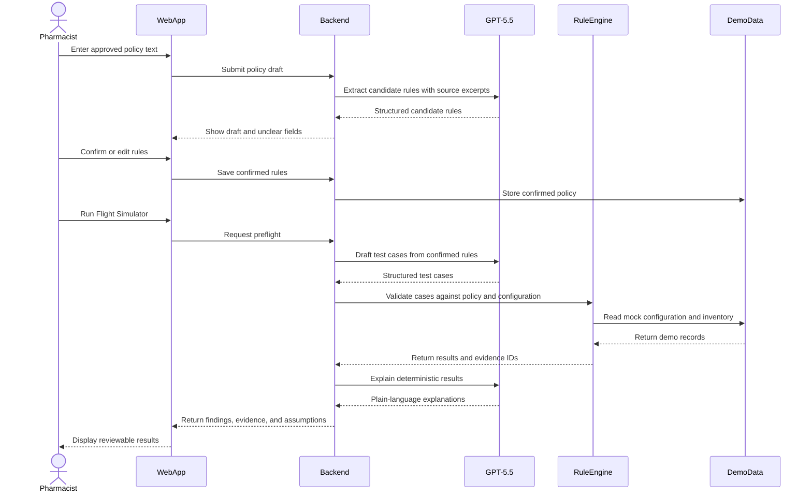
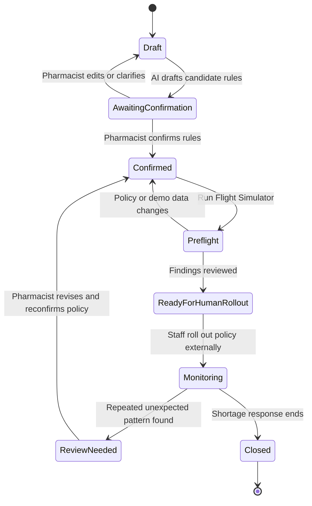

# Shortage Rollout Checker — Builder Plan

**Plan date:** November 14, 2026  
**Plan audience:** Hackathon builders  
**Working product name:** Shortage Rollout Checker  
**Product form:** Browser-based web app  
**Hackathon mode:** Fictional data; no special hardware or live hospital connection

## 1. Product summary

Shortage Rollout Checker helps hospital pharmacy teams test and verify how an already-approved medication-shortage policy is applied across a hospital’s systems. It combines four features:

1. **Policy Rollout Checker:** maps a confirmed policy to potentially affected systems and flags inconsistencies.
2. **Shortage Flight Simulator:** tests sample orders against the policy before rollout.
3. **Shortage Ripple Map:** models how an approved alternative could shift supply pressure across medications, departments, or locations.
4. **Shadow Mode:** observes a fictional, read-only stream after rollout and surfaces repeated unexpected patterns.

The product is an implementation and verification layer. It is not a shortage forecasting platform, clinical decision-support system, or medication recommender.

### Product statement

> Help pharmacy teams test, roll out, and monitor approved shortage policies so outdated instructions and unexpected workflow problems are easier to find.

## 2. Product problem

When a hospital changes how a medication is used during a shortage, staff may need to update several places: EHR order sets, automated dispensing cabinets, smart-pump settings, purchasing records, and staff instructions. If those places do not agree, staff may encounter outdated or confusing workflows.

ASHP guidance describes coordinating updates across systems such as EHRs, smart-pump libraries, and automated dispensing cabinets as part of shortage management. It also notes that alternative medications can be affected by increased demand. See [ASHP Guidelines on Managing Drug Product Shortages](https://academic.oup.com/ajhp/article/75/21/1742/5160014).

### Specific problem

**After a pharmacy team approves a shortage policy, how can the team check that it is applied consistently, test likely edge cases before rollout, and notice unexpected patterns afterward?**

### Market assumption to validate

Existing products already offer shortage forecasting, inventory visibility, scenario planning, sourcing, and collaboration. The proposed opportunity is the narrower workflow of policy testing and rollout verification. Public product descriptions do not prove that incumbent products lack this capability. Pharmacist interviews and vendor demos are needed before claiming this is a market gap.

## 3. Product vision

Create a human-reviewed “preflight and follow-through” workspace for shortage policies:

1. **Prepare:** capture the approved policy and identify affected departments and systems.
2. **Preflight:** simulate sample orders and supply changes before launch.
3. **Roll out:** show a reviewable checklist of possible system updates and owners.
4. **Monitor:** compare read-only post-rollout events with expected behavior and surface recurring surprises.

The app should help the team answer: **“Did we apply the plan consistently, and is it behaving as expected?”**

## 4. Target audience

### Primary users

- Hospital pharmacists coordinating medication-shortage responses
- Pharmacy informatics staff
- Medication-safety analysts

### Supporting users

- Pharmacy buyers and technicians
- EHR analysts and medication-system administrators
- Nursing or clinical-education leads
- Pharmacy directors overseeing rollout status

### Likely buyer

A hospital pharmacy department or health-system pharmacy operations team. The hackathon prototype demonstrates a workflow; it is not a procurement-ready product.

## 5. Product scope

### In scope for the hackathon

- Browser-based dashboard
- Fictional, non-patient medication and department data
- Seeded demo data and optional CSV/JSON fixture import
- Approved-policy intake using pasted text or a sample document
- AI-assisted conversion of policy language into a reviewable draft
- Human confirmation of extracted rules
- Rollout checklist and mismatch review
- Flight Simulator using generated or seeded sample orders
- Ripple Map using fictional inventory and pharmacist-approved alternative links
- Shadow Mode over fictional, read-only events
- Evidence and assumptions shown with every finding
- Human review states and demo activity history

### Out of scope for the hackathon

- Real patient data or protected health information
- Diagnosis, prescribing, medication substitution, or patient prioritization
- Automated writes to EHRs, cabinets, smart pumps, procurement systems, or live data
- Claims that a finding is clinically correct without pharmacist review
- Production hospital integrations, security certification, or regulatory validation
- Predicting national shortages or replacing incumbent shortage platforms
- Meta Glasses or other specialized hardware

## 6. Feature definitions

### 6.1 Policy Rollout Checker

The pharmacist provides an approved policy. The app drafts a structured view of relevant rules: medication, department, condition, restriction, approved alternative if specified, effective date, and source text. The pharmacist confirms or edits the draft. The app compares confirmed rules with mock system records and flags possible mismatches.

### 6.2 Shortage Flight Simulator

Before rollout, the agent drafts sample cases based on confirmed rules. A deterministic rules engine checks those cases against the policy and mock system configuration. Results show expected behavior, observed behavior, and the rule involved.

Example: a sample order from a restricted department appears allowed in an imported EHR configuration. The app flags this for review; it does not change the configuration.

### 6.3 Shortage Ripple Map

The map shows how a pharmacist-approved alternative may affect inventory in other departments or locations. It uses fictional or imported quantities, usage rates, and approved alternative links. Application code performs the calculations; the language model does not invent the math.

Each connection shows its assumptions and source data—for example, “Alternative B is approved for this scenario” and “projected use is based on the supplied mock rate.”

### 6.4 Shadow Mode

After rollout, Shadow Mode reads a fictional event stream and compares observed events with confirmed policy rules. It groups repeated patterns—such as recurring workarounds or usage that differs from expectations—and presents them for pharmacist review.

Shadow Mode is read-only. It does not block orders, alter clinical workflows, or send instructions to staff.

### 6.5 Evidence and activity history

Each finding includes the relevant policy rule, record, calculation assumptions, and review status. The activity history shows who confirmed or dismissed a finding in the demo.

## 7. AI model and system design

### Recommended model

Use **`gpt-5.5` through the OpenAI Responses API** for policy interpretation, clarification questions, test-case drafting, and concise explanations. OpenAI’s API documentation currently lists GPT-5.5 with function calling and structured-output support. Confirm API access for the hackathon account before building; keep the model name in an environment variable so it can be changed if needed. References: [OpenAI API models](https://developers.openai.com/api/docs/models), [API changelog](https://developers.openai.com/api/docs/changelog), [function calling](https://developers.openai.com/api/docs/guides/function-calling), and [Structured Outputs](https://developers.openai.com/api/docs/guides/structured-outputs).

### What the model does

- Extracts candidate rules from pharmacist-provided policy text
- Identifies ambiguity and asks the user to clarify it
- Drafts test scenarios from confirmed rules
- Chooses among a small set of read-only application tools
- Groups similar Shadow Mode events for review
- Explains deterministic results in plain language with evidence references

### What ordinary code does

- Validates model output against schemas
- Calculates inventory and scenario changes
- Runs policy checks against test orders and mock configurations
- Builds the Ripple Map from approved links and supplied inventory data
- Groups events using defined conditions and thresholds
- Enforces review states and audit records

The model must not decide what treatment is appropriate, invent approved alternatives, or execute production changes.

### Proposed read-only tools

- `get_confirmed_policy(policy_id)`
- `get_mock_configuration(policy_id)`
- `get_sample_orders(policy_id, scenario_id)`
- `run_policy_simulation(policy_id, scenario_id)`
- `get_inventory_snapshot(medication_ids)`
- `build_ripple_projection(policy_id, scenario_id)`
- `get_shadow_events(policy_id, time_window)`
- `create_review_finding(finding_payload)`
- `update_review_status(finding_id, status, note)`

Do not implement tools that modify live policy, inventory, or system configuration.

## 8. Data model for the demo

Use fictional medication IDs and names. Every record should have a stable ID so findings can point back to their evidence.

- **PolicyRule:** `id`, `policy_id`, `medication_id`, `department_id`, `condition`, `restriction`, `approved_alternative_id`, `effective_date`, `source_excerpt`, `confirmed_by_user`
- **SystemConfig:** `id`, `system_type`, `department_id`, `medication_id`, `enabled`, `instruction_text`, `source_record_id`
- **TestCase:** `id`, `policy_id`, `department_id`, `medication_id`, `scenario_text`, `expected_outcome`, `source_rule_id`
- **Inventory:** `medication_id`, `location_id`, `quantity_on_hand`, `average_daily_use`, `minimum_reserve`
- **AlternativeLink:** `source_medication_id`, `alternative_medication_id`, `approved_condition`, `approved_by_role`
- **ShadowEvent:** `id`, `timestamp`, `department_id`, `medication_id`, `event_type`, `result`, `source_record_id`
- **Finding:** `id`, `feature`, `severity`, `summary`, `evidence_ids`, `assumptions`, `review_status`, `created_at`

No patient names, identifiers, or real patient-level clinical records belong in the demo dataset.

## 9. Language and safety rules

### Use plain, neutral wording

- “Possible mismatch — pharmacist review needed”
- “Simulation result — based on supplied sample data”
- “Observed pattern — no change made”
- “The policy text does not specify this case”

Avoid statements such as “The AI recommends this medication” or “This order is unsafe.” Describe the record and the policy rule that appears inconsistent; leave the clinical judgment to the pharmacist.

### Data and approval rules

- Use fictional data for the demo.
- Require a human to confirm extracted policy rules before simulation.
- Clearly label assumptions, mock data, and AI-generated drafts.
- Keep API credentials on the backend, never in browser code.
- Keep all feature outputs review-only and traceable to their source records.

## 10. Interface outline

1. **Overview:** active demo policies and unresolved findings.
2. **Policy Setup:** paste or upload sample policy text and review extracted rules.
3. **Rollout Review:** affected mock systems, departments, and possible mismatches.
4. **Flight Simulator:** choose a scenario, run sample orders, review results.
5. **Ripple Map:** inspect medications, departments, inventory assumptions, and projected changes.
6. **Shadow Mode:** view event patterns and compare them with expected policy behavior.
7. **Finding Detail:** evidence, rule, data source, assumptions, and review controls.
8. **Activity History:** prototype actions and review status.

Use a contextual AI explanation panel inside each feature. Lead with evidence and status, not a blank chatbot screen.

## 11. Product backlog

Priority key: **P0** required for the end-to-end demo; **P1** improves the demo if time allows; **P2** future validation or production work. Each backlog item is written as an implementation task with a visible result.

### Epic A — Project setup and shared data

- **A1 (P0):** Create the frontend and backend folders, install dependencies, and add one command or documented pair of commands to start both services.
- **A2 (P0):** Add `.gitignore` entries for `.env`, local databases, caches, and generated build files.
- **A3 (P0):** Add `.env.example` with `OPENAI_API_KEY=` and `OPENAI_MODEL=gpt-5.5` placeholders only; never put a real credential in this file.
- **A4 (P0):** Define shared schemas for `ShortagePolicy`, `PolicyRule`, `Medication`, `Department`, `SystemConfig`, `Inventory`, `AlternativeLink`, `TestCase`, `ShadowEvent`, and `Finding`.
- **A5 (P0):** Create fictional seed data with two departments, three fictional medications, one approved alternative link, one configuration mismatch, and at least six mock events.
- **A6 (P0):** Add a backend seed/reset action and a frontend “Load demo data” button so the demo starts from the same state every time.
- **A7 (P1):** Add CSV/JSON upload for selected mock tables and show row-level validation errors.
- **A8 (P0):** Add a backend health endpoint and configure local frontend-to-backend requests.

### Epic B — API key and model connection

- **B1 (P0):** Document where the backend owner puts their own API key in a local, untracked `backend/.env` file.
- **B2 (P0):** Load `OPENAI_API_KEY` and `OPENAI_MODEL` through backend settings; stop startup with a clear message if the key is missing when live AI mode is enabled.
- **B3 (P0):** Add a backend-only `POST /api/ai/check` or startup check that makes one harmless Responses API request and returns only a success/failure status to the UI.
- **B4 (P0):** Verify that the browser never receives the API key: no frontend environment variable, HTML, JavaScript bundle, or API response may contain it.
- **B5 (P0):** Handle invalid key, rate limit, timeout, network failure, and API error with a readable message; never log the secret or full authorization headers.
- **B6 (P0):** Add a mock-AI mode so the full demo remains usable without network access or a working API credential.
- **B7 (P1):** Add a model-call log containing request purpose, duration, and status only; do not log policy text or credentials.
- **B8 (P0):** Define strict function-tool schemas for reading confirmed policies, configurations, inventory, test cases, and Shadow Mode events.
- **B9 (P0):** Implement a backend tool dispatcher that allowlists those functions, validates arguments, calls application services, and returns tool results to the model. Reject unknown tools and any tool that would modify live systems.

### Epic C — Policy intake and confirmation

- **C1 (P0):** Build a screen to paste the fictional approved policy text and submit it to the backend.
- **C2 (P0):** Add a Responses API call that drafts structured policy rules using a defined schema.
- **C3 (P0):** Store the exact source excerpt associated with every candidate rule.
- **C4 (P0):** Validate required fields and display missing or ambiguous information as questions.
- **C5 (P0):** Allow the pharmacist persona to edit, confirm, or reject each candidate rule.
- **C6 (P0):** Prevent unconfirmed rules from being used by the simulator, Ripple Map, or Shadow Mode.
- **C7 (P1):** Allow the user to reopen a confirmed rule for revision and keep a simple version history.

### Epic D — Rollout checker

- **D1 (P0):** Display mock system configuration records by system type, medication, and department.
- **D2 (P0):** Implement deterministic checks that compare confirmed rules with mock configuration records.
- **D3 (P0):** Create a finding for each mismatch with rule ID, source record ID, reason, and review status.
- **D4 (P0):** Build a Rollout Review page with filters for department, system, and finding status.
- **D5 (P0):** Add controls to mark a finding “Needs review,” “Expected,” or “Dismissed,” with an optional note.
- **D6 (P1):** Export the reviewed rollout checklist to CSV or a printable page.

### Epic E — Shortage Flight Simulator

- **E1 (P0):** Draft at least three test cases from confirmed rules or load the supplied sample cases.
- **E2 (P0):** Validate every generated test case against the `TestCase` schema before it can run.
- **E3 (P0):** Implement a deterministic evaluator that compares expected policy behavior with the mock system configuration.
- **E4 (P0):** Show each case as Pass, Possible mismatch, or Needs clarification, with the rule and record behind the result.
- **E5 (P0):** Label every run “Simulation only — based on supplied sample data.”
- **E6 (P1):** Let a user change a mock configuration and rerun the same cases to see whether the finding changes.

### Epic F — Shortage Ripple Map

- **F1 (P0):** Store approved alternative relationships as directed links; reject links not marked as approved in the demo data.
- **F2 (P0):** Implement a transparent projection using supplied quantity, use-rate, and scenario-shift values.
- **F3 (P0):** Add input validation for missing, negative, or inconsistent inventory values.
- **F4 (P0):** Display medication/location nodes and the direction of potential use shifts.
- **F5 (P0):** Show each projection’s formula, inputs, assumptions, and warning that it is not a clinical recommendation.
- **F6 (P1):** Compare two user-selected scenarios side by side.

### Epic G — Shadow Mode

- **G1 (P0):** Load the fictional event stream without connecting to or changing a live system.
- **G2 (P0):** Compare each event with confirmed rules using deterministic conditions.
- **G3 (P0):** Group repeated deviations by policy, department, event type, and time window.
- **G4 (P0):** Create a finding that shows event count, representative source IDs, time window, and why the pattern was flagged.
- **G5 (P0):** Build a Shadow Mode page that clearly labels all results read-only and review-only.
- **G6 (P0):** Add review controls for “Expected,” “Dismissed,” and “Review policy,” with a note field.
- **G7 (P1):** Let an accepted Shadow Mode finding become a new Flight Simulator case after user confirmation.

### Epic H — Shared interface and evidence

- **H1 (P0):** Add navigation for Overview, Policy Setup, Rollout Review, Flight Simulator, Ripple Map, and Shadow Mode.
- **H2 (P0):** Build a reusable finding card with severity/status, short explanation, and evidence link.
- **H3 (P0):** Build a detail panel that shows the policy excerpt, source record, assumptions, calculation inputs, and review history.
- **H4 (P0):** Add loading, empty, validation-error, API-error, and mock-data states to each main page.
- **H5 (P0):** Add visible “Demo data” labels and a reset control.
- **H6 (P1):** Add keyboard navigation, readable contrast, and text labels for status icons.

### Epic I — Integration, validation, and presentation

- **I1 (P0):** Connect the four feature pages to the same confirmed policy and shared demo dataset.
- **I2 (P0):** Add a complete demo script that can be completed in under five minutes.
- **I3 (P0):** Walk through the demo from a clean reset and verify every button used in the script has a visible result.
- **I4 (P0):** Confirm no real patient data is present and no production write action exists.
- **I5 (P0):** Rehearse with live API mode and mock mode; keep the mock mode available as a fallback.
- **I6 (P1):** Ask a pharmacist or pharmacy-informatics contact to review the wording and product boundary if one is available.

### Epic J — Future work

- **J1 (P2):** Validate whether incumbent products already provide shortage-specific policy simulation and post-rollout verification.
- **J2 (P2):** Review the workflow with hospital pharmacists and pharmacy-informatics staff.
- **J3 (P2):** Explore secure, read-only integrations with a health-system partner.
- **J4 (P2):** Review privacy, security, governance, and deployment requirements with a health-system partner.
- **J5 (P2):** Evaluate false positives, missed issues, review time, and staff trust using approved evaluation data.

## 12. Hackathon sprint plan

**Planning assumption:** about 24 hours of build time. The six sprints below are short, sequential build cycles totaling about 22 hours, leaving roughly two hours for breaks, integration surprises, and final presentation. If the event is shorter, complete all P0 work and drop P1 work first.

### Sprint 1 — Project foundation and data contract (about 3 hours)

**Goal:** The app runs locally, the backend and frontend agree on data shapes, and the team can load a repeatable fictional scenario.

**Sprint backlog:** A1–A6, A8; start H1.

**Instructions:**

1. Create the frontend and backend directories and install only the dependencies needed for the demo.
2. Add `.gitignore` rules for `.env`, local SQLite files, caches, and build output.
3. Add `.env.example` with placeholder variable names only. Do not put a real API key in it.
4. Agree on the shared data schemas before dividing feature work. Put the schema definitions in the backend and mirror the fields in frontend types.
5. Seed fictional data that includes one known stale configuration record, one approved alternative, and enough events to produce a Shadow Mode pattern.
6. Add a reset/load-demo-data control. Start both services and confirm the Overview page displays the seeded data.

**Acceptance criteria:**

- A teammate can follow the README and start both services.
- “Load demo data” restores the same dataset every time.
- The dataset contains no real patient information.
- `.env` is ignored by Git and `.env.example` contains no credential.

### Sprint 2 — API key setup and policy intake (about 4 hours)

**Goal:** The backend can make a safe, server-side model request, and a user can turn sample policy text into a confirmed structured draft.

**Sprint backlog:** B1–B6, B8–B9, C1–C6.

**Instructions:**

1. The designated backend owner creates or uses an authorized OpenAI API credential. Do not paste the secret into chat, source code, a shared plan, or a frontend setting.
2. Put the credential in the backend’s local, untracked `.env` as `OPENAI_API_KEY=...`; set `OPENAI_MODEL=gpt-5.5` there as well. Keep `.env.example` as placeholders only.
3. Add backend settings that load the key and model name. If live mode is selected and the key is missing, show a clear setup error instead of silently failing.
4. From the backend only, send a harmless first request to the Responses API. Return only success/failure status to the browser. Check the code and browser network response to ensure the secret is never returned or logged.
5. Add error handling for missing key, invalid key, rate limit, timeout, and network failure. Confirm mock mode still works without a key.
6. Build the policy input screen. Ask the model to return candidate rules in the defined schema, including source excerpts.
7. Validate the response on the backend. Show unclear fields as questions and require a human confirmation click before saving confirmed rules.

**Acceptance criteria:**

- A valid local key produces a successful backend model check.
- An invalid or missing key produces a readable error without exposing the key.
- The key is not present in frontend files, browser storage, network responses, or Git changes.
- Candidate policy rules cannot be used by other features until confirmed.
- Mock mode can complete policy intake if the API is unavailable.

### Sprint 3 — Rollout checker and evidence review (about 4 hours)

**Goal:** A confirmed policy can be compared with mock system records and reviewed finding by finding.

**Sprint backlog:** D1–D5, H2–H5, I1.

**Instructions:**

1. Display configuration records grouped by system type, medication, and department.
2. Implement simple, deterministic comparisons between confirmed policy rules and mock configurations. Do not use the model to decide whether a record matches.
3. For each mismatch, create a finding with the rule ID, source record ID, reason, and review status.
4. Add filters for department, system type, and status.
5. Add “Needs review,” “Expected,” and “Dismissed” actions. Save the reviewer’s selection and optional note in the demo activity history.
6. Add evidence details: policy excerpt, configuration record, and plain-language explanation.

**Acceptance criteria:**

- The seeded stale record produces the expected finding.
- A reviewer can open the evidence and mark the finding.
- Changing unrelated records does not create unrelated findings.
- Findings are clearly labeled as possible mismatches for review.

### Sprint 4 — Flight Simulator and Ripple Map (about 5 hours)

**Goal:** A user can test sample orders against the confirmed policy and see a transparent supply ripple projection.

**Sprint backlog:** E1–E5, F1–F5, I1.

**Instructions:**

1. Load at least three test cases: one expected to pass, one expected to flag a mismatch, and one that needs clarification.
2. Optionally use the model to draft test cases, but validate their schema and show them for human confirmation before running them.
3. Implement the evaluator as normal backend code. Show expected outcome, observed outcome, rule ID, and evidence for every case.
4. Add the Ripple Map’s approved alternative links and mock inventory values.
5. Calculate the projection using a visible formula and supplied use-rate assumptions. Validate missing, negative, or inconsistent values instead of inventing replacements.
6. Draw the medication/location links and show where projected use shifts. Label it “simulation only; not a clinical recommendation.”

**Acceptance criteria:**

- The same test data always produces the same rule-engine result.
- Three cases display their expected and observed outcomes.
- The Ripple Map shows at least two connected medications and one location-level projection.
- Every projected number has visible inputs and assumptions.

### Sprint 5 — Shadow Mode (about 3 hours)

**Goal:** A read-only event stream produces a clear finding when repeated events differ from the confirmed policy or expected pattern.

**Sprint backlog:** G1–G6, H2–H5, I1.

**Instructions:**

1. Load the fictional event stream from local demo data; do not connect to a live hospital system.
2. Compare events with confirmed policy conditions using deterministic code.
3. Group repeated events by policy, department, event type, and time window.
4. Create a finding showing the count, representative event IDs, time window, and comparison rule.
5. Use the model only to draft a concise explanation of a finding already produced by code; attach the event IDs and policy excerpt.
6. Add review actions and clearly state that Shadow Mode is read-only. It must not block, reroute, or edit orders.

**Acceptance criteria:**

- The seeded event pattern creates one understandable finding.
- A single unrelated event does not appear as a repeated pattern.
- The user can mark the pattern expected, dismissed, or for policy review.
- The interface offers no live system write action.

### Sprint 6 — Integration, demo hardening, and presentation (about 3 hours)

**Goal:** The end-to-end story works reliably from a clean reset, with API and mock modes available.

**Sprint backlog:** I2–I5, H3–H6, B6, all remaining P0 items.

**Instructions:**

1. Run the full story in order: load data → enter policy → confirm rules → review mismatch → run simulation → inspect ripple → view Shadow Mode.
2. Fix broken links between pages and ensure every feature uses the same confirmed policy and dataset.
3. Check every error/empty/loading state used in the presentation.
4. Verify API-key handling again: `.env` ignored, key only used by backend, no secret in logs or UI.
5. Reset the demo and repeat it once in live API mode and once in mock mode.
6. Prepare a five-minute presentation explaining the problem, what the AI does, what ordinary code does, and what remains for pharmacist review.
7. If time remains, take P1 tasks; do not add live integrations or production write actions.

**Acceptance criteria:**

- The full demonstration can be completed in under five minutes after reset.
- Both live and mock modes have a clear status indicator.
- Every finding is traceable to evidence and assumptions.
- No real patient data or production integration is used.

## 13. Builder working instructions

- Use one shared schema and fixture dataset.
- Complete each sprint’s acceptance criteria before pulling in P1 work.
- Keep model calls on the backend; never expose the API key in browser code.
- Treat model output as a draft until validated and confirmed by a human.
- Use application code for calculations, comparisons, thresholds, and graph building.
- Give every finding an evidence reference and a plain-language reason.
- Do not implement production write actions.
- Maintain mock mode so the demo works without external services.
- If the live model fails, keep the demo moving with the labeled mock response; never hide that it is mock output.

## 14. Proposed file map

```text
shortage-rollout-checker/
├── README.md
├── .env.example
├── .gitignore
├── frontend/
│   ├── package.json
│   └── src/
│       ├── app/
│       │   ├── App.tsx
│       │   └── routes.tsx
│       ├── pages/
│       │   ├── OverviewPage.tsx
│       │   ├── PolicySetupPage.tsx
│       │   ├── RolloutReviewPage.tsx
│       │   ├── FlightSimulatorPage.tsx
│       │   ├── RippleMapPage.tsx
│       │   └── ShadowModePage.tsx
│       ├── components/
│       │   ├── FindingCard.tsx
│       │   ├── EvidencePanel.tsx
│       │   ├── StatusBadge.tsx
│       │   └── Navigation.tsx
│       ├── api/client.ts
│       ├── types/index.ts
│       └── styles/global.css
├── backend/
│   ├── pyproject.toml
│   ├── .env  # local only; ignored by Git; never commit
│   └── app/
│       ├── main.py
│       ├── core/
│       │   └── config.py
│       ├── api/
│       │   ├── policies.py
│       │   ├── rollout.py
│       │   ├── simulator.py
│       │   ├── ripple.py
│       │   └── shadow.py
│       ├── schemas/
│       │   ├── policy.py
│       │   ├── medication.py
│       │   ├── scenario.py
│       │   └── finding.py
│       ├── services/
│       │   ├── policy_parser.py
│       │   ├── rollout_checker.py
│       │   ├── flight_simulator.py
│       │   ├── ripple_engine.py
│       │   ├── shadow_analyzer.py
│       │   └── audit_log.py
│       ├── ai/
│       │   ├── client.py
│       │   ├── prompts.py
│       │   └── tools.py
│       ├── validation/
│       │   ├── policy_rules.py
│       │   └── scenario_checks.py
│       └── data/
│           ├── seed_demo.py
│           └── fixtures/
│               ├── policy.json
│               ├── configurations.json
│               ├── inventory.json
│               ├── alternatives.json
│               └── events.json
└── docs/
    ├── product-scope.md
    ├── data-dictionary.md
    └── demo-script.md
```

### Suggested stack

- **Frontend:** React, TypeScript, Vite
- **Backend:** Python, FastAPI, Pydantic
- **Demo storage:** JSON fixtures or SQLite
- **AI:** OpenAI Responses API, `gpt-5.5`, function calling, Structured Outputs
- **Visualization:** simple React graph or node-link component for the Ripple Map

This is a proposed stack, not a requirement. Keep the API model name configurable and use the framework the team can build with fastest.

## 15. Demo narrative

1. Load a fictional hospital and a shortage policy.
2. Confirm the policy rules extracted by the agent.
3. Open Rollout Review and inspect the outdated mock instruction.
4. Run the Flight Simulator and see which sample order reveals the mismatch.
5. Open the Ripple Map and show the projected effect of increased alternative use.
6. Open Shadow Mode and see a repeated post-rollout workaround in the mock event stream.
7. State clearly that findings are evidence for staff review; the app does not make clinical choices or change live systems.

## 16. Success criteria for the prototype

- The user can complete the demo without developer assistance.
- Extracted policy rules require human confirmation.
- Each finding shows its rule and supporting mock record.
- Simulation and Ripple Map results are reproducible from visible inputs.
- Shadow Mode is visibly read-only.
- The app works with fictional data and has a mock fallback.
- The team can state the proposed market distinction without claiming it is proven.

## 17. Research references

- [ASHP Guidelines on Managing Drug Product Shortages](https://academic.oup.com/ajhp/article/75/21/1742/5160014)
- [Bluesight ShortageCheck](https://bluesight.com/drug-shortage-software/)
- [Quva BrightStream Shortage Navigator](https://onequva.com/brightstream/shortage-navigator)
- [Merative OrbitalRX with Micromedex](https://www.merative.com/clinical-decision-support/pharmacy-inventory-management)
- [OpenAI API models](https://developers.openai.com/api/docs/models)
- [OpenAI Responses API function calling](https://developers.openai.com/api/docs/guides/function-calling)
- [OpenAI Structured Outputs](https://developers.openai.com/api/docs/guides/structured-outputs)

## 18. UML diagrams

These diagrams describe the hackathon prototype. The AI suggests structured drafts and explanations; deterministic services run the checks and calculations. Human review remains required, and the prototype makes no live system changes.

### 18.1 Domain class diagram

This class diagram shows the core records and how policies, medications, system configurations, simulations, events, findings, and evidence relate.



### 18.2 Sequence diagram: policy preflight

This sequence shows how policy text moves through the app. The model drafts structured rules and sample cases; the application validates them and runs the simulation.



### 18.3 State diagram: policy lifecycle

This state diagram separates pharmacist confirmation from the product’s checks. “Ready for rollout” does not mean the app deploys changes; staff carry out rollout through their approved hospital process.



